<p align="center">
  
</p>

<h1 align="center">Taskbaroque</h1>

<p align="center">
  A lightweight, fully customizable taskbar for Windows 11.<br>
  A notch, widgets, themes and a pet that wanders along the edge of your bar.
</p>

<p align="center">
  <a href="https://github.com/ahmetcdincer/taskbaroque/releases/latest"><b>⬇ Download</b></a> ·
  <a href="README.md">Türkçe</a>
</p>

<p align="center">
  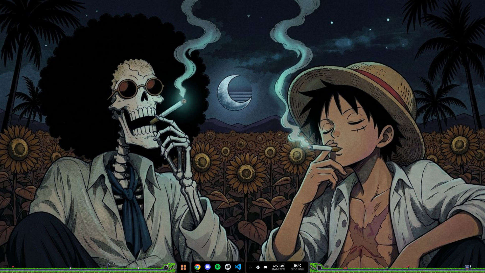
</p>

---

## Why Taskbaroque?

- **Lightweight.** Written in Rust directly on Win32 and Direct2D. No browser engine and no heavy framework running in the background. Everything lives in a single `.exe`.
- **Your desktop stays intact.** The Windows taskbar is only hidden, and the "auto-hide" setting is never touched. Icons and windows don't shift.
- **Multi-monitor.** Each screen gets its own bar. Optionally, each bar shows only the windows on its own screen.
- **Safe exit.** When you quit, the Windows taskbar comes back right away.

## Installation

1. Download `Taskbaroque-Setup-x.y.z.exe` from the [Releases](https://github.com/ahmetcdincer/taskbaroque/releases/latest) page.
2. Run it. No administrator rights are needed.
3. During setup, you can choose a desktop shortcut and "Start with Windows".

To uninstall, pick Taskbaroque under **Settings → Apps**. Your settings are kept, so a reinstall picks up where you left off.

> **Requirements:** Windows 11, 64-bit.

---

## Features

### Taskbar

- **Four layouts:** Rounded, Modular, Dock and Full width. In full width, the Start button stays centered.
- **Grouped windows.** Windows of the same app share one icon. Hovering opens live previews where you can switch to a window or close it.
- **Drag and drop.** Hold a file over an icon and the app comes to the front. If it has several windows, the previews open.
- **Pinning.** Pin apps to the bar. Your Windows taskbar pins are imported automatically on first launch.
- **Ordering.** Drag icons to rearrange them. Newly opened apps are added on the right, and your order is kept.
- **Right-click menu.** The app's own options, recent files, Task Manager, pinning and hiding in one place.
- **Apps that need attention.** When an app asks for attention, its icon lights up orange.
- **Notification area.** Tray icons and the hidden icons panel. Single and double clicks work just like in Windows.
- **Right cluster.** Weather, CPU and RAM, battery, clock and virtual desktop dots.
- **Your own launcher.** The Start button can open a fast app search instead of the Windows menu. You can also replace the Start icon with your own image.
- **Keyboard shortcuts.** `Win + 1…9` opens the apps on the bar, and `Alt + Space` opens the launcher.
- **Fullscreen detection.** While a game or video is fullscreen, the bar hides itself on that screen.

### Notch

A panel at the top of the screen that opens when you hover over it. Small audio bars move while music is playing. A volume indicator appears when you change the volume, and a warning appears while the microphone or camera is in use. Visibility options: always, while media is playing, on hover, or off.

| | |
|---|---|
| 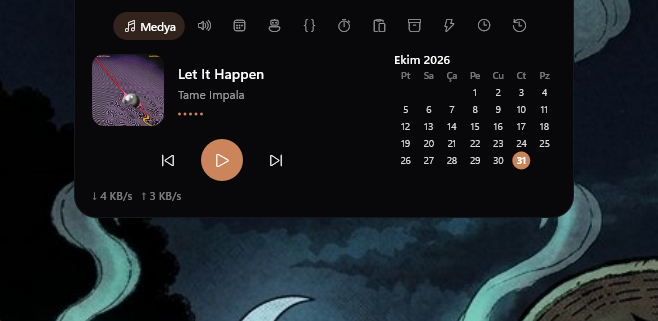 | 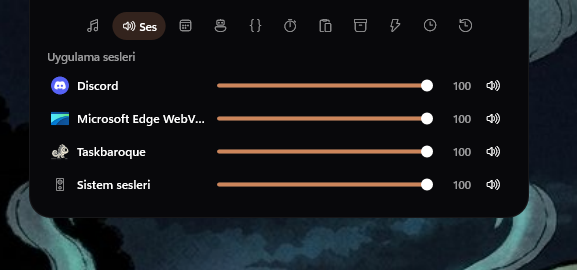 |
| **Media:** The current song, cover art, controls, calendar and network speed. | **Sound:** A separate volume level for each app. |
| 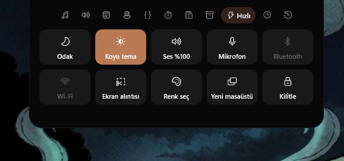 | 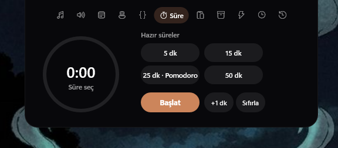 |
| **Quick:** Focus mode, dark theme, volume, microphone, Bluetooth, Wi-Fi, screenshot, color picker, new desktop and lock. | **Timer:** Preset durations and a Pomodoro timer. |
| 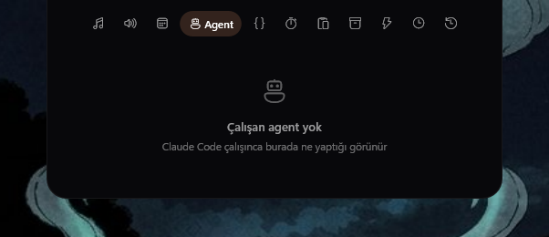 | 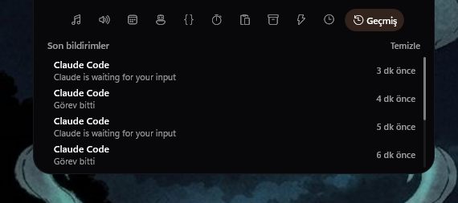 |
| **Agent:** What Claude Code is doing right now, live. | **History:** Recent notifications. Click one to jump to its app. |

Other tabs:

- **Agenda:** Events from your Google or Outlook calendar (via an ICS link).
- **GitHub:** Open PRs and CI status (via the `gh` CLI).
- **Clipboard:** Things you copied recently.
- **Shelf:** A place to drop files temporarily.
- **Screen time:** How much time you spent in each app today. A short daily summary arrives in the evening.

The Quick tab also shows the battery level of Bluetooth devices such as headphones and mice. You get a warning when one runs low.

### Widgets

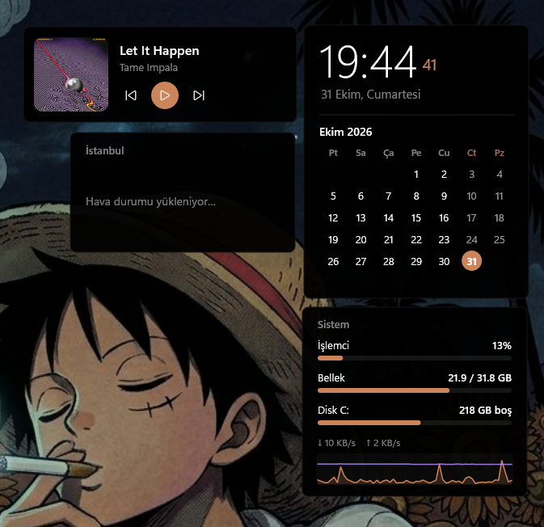

- **Clock and calendar**
- **Weather** (Open-Meteo, no API key needed)
- **Media:** Cover art and controls.
- **System monitor:** CPU, RAM, disk, network and a 60-second graph.

Drag widgets to move them, even to another screen, and lock them in place. Their positions are saved automatically.

### Pet and terrain

A pixel-art character that wanders beside the bar: **Puppy, Fox, Hedgehog, Chameleon** or **Firefly**. Pick it up with the mouse to move it, or right-click to turn it off.

The sides of the bar can show **grassy terrain** or **a road with tunnels**. Every now and then a car drives along the road, entering one tunnel and coming out of the other. The scene changes at night and in snowy weather.

### Themes

12 built-in themes: Midnight blue, Light, Aurora, Frosted glass, Neon, Forest, Brushed metal, Retro pixel, Pastel, Minimal, Sunset and Black (AMOLED). Optionally, the accent color is taken from your wallpaper.

### Notifications

Taskbaroque can receive notifications from tools running in your terminal or code editor and show them in the notch. Clicking a notification brings the matching window to the front.

**Claude Code:** Add these hooks to `%USERPROFILE%\.claude\settings.json`, replacing `<user>` with your user name:

```json
{
  "hooks": {
    "UserPromptSubmit": [{ "hooks": [{ "type": "command", "command": "\"C:/Users/<user>/AppData/Local/Programs/Taskbaroque/taskbaroque.exe\" --hook" }] }],
    "PreToolUse":       [{ "hooks": [{ "type": "command", "command": "\"C:/Users/<user>/AppData/Local/Programs/Taskbaroque/taskbaroque.exe\" --hook" }] }],
    "Notification":     [{ "hooks": [{ "type": "command", "command": "\"C:/Users/<user>/AppData/Local/Programs/Taskbaroque/taskbaroque.exe\" --hook" }] }],
    "Stop":             [{ "hooks": [{ "type": "command", "command": "\"C:/Users/<user>/AppData/Local/Programs/Taskbaroque/taskbaroque.exe\" --hook" }] }],
    "SessionEnd":       [{ "hooks": [{ "type": "command", "command": "\"C:/Users/<user>/AppData/Local/Programs/Taskbaroque/taskbaroque.exe\" --hook" }] }]
  }
}
```

When you update the app or install it to another folder, these paths are fixed automatically. Uninstalling removes the hooks too.

**Your own commands:** Send a notification from any script:

```powershell
taskbaroque.exe --notify "Build finished" --title "Warp" --sound
```

---

## Settings

To open the settings window, right-click the bar and choose **Settings**. Everything can be changed there, and changes apply instantly. (The screenshots below show the Turkish interface.)

| | |
|---|---|
| 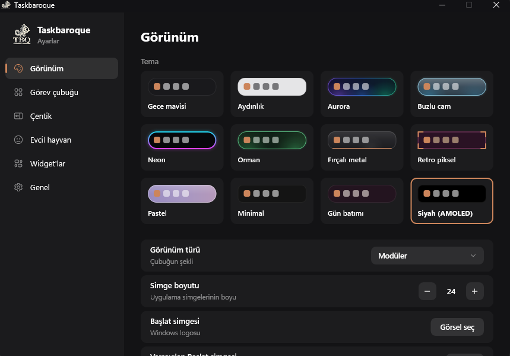 | 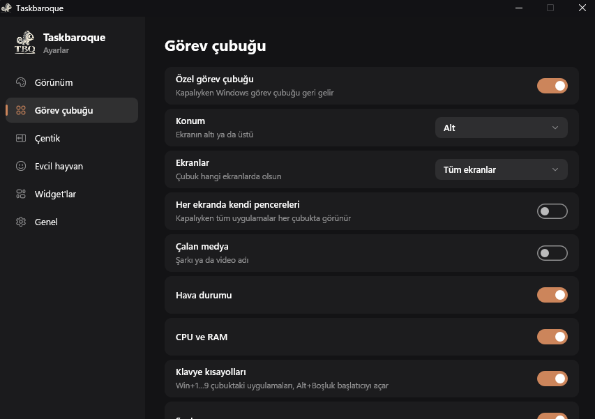 |
| 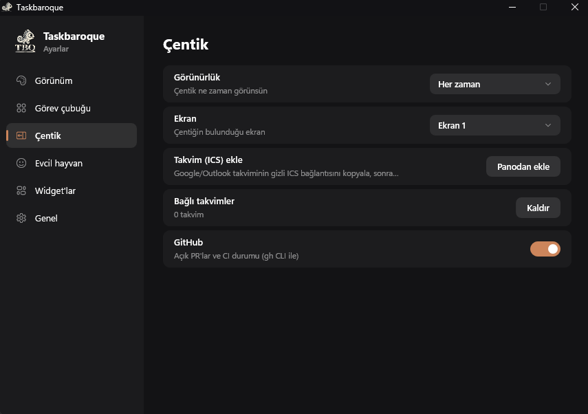 | 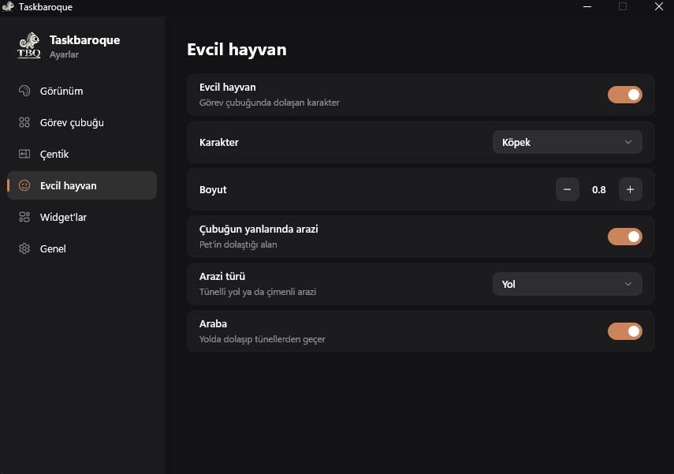 |
| 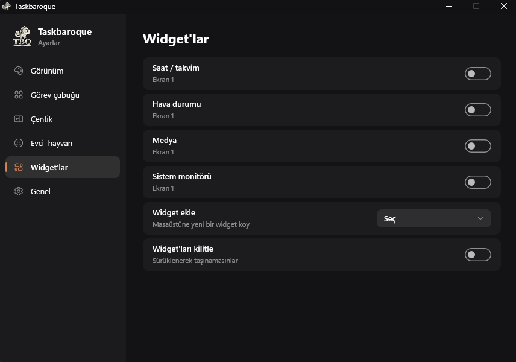 | 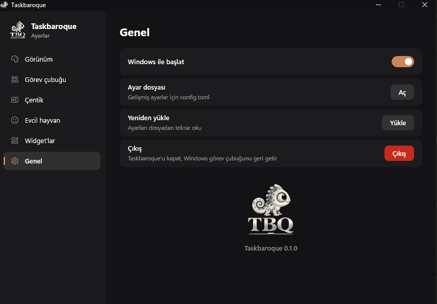 |

Advanced settings live in `%APPDATA%\Taskbaroque\config.toml`. Changes apply as soon as you save the file. You can also define your own theme with a `[themes.name]` section.

The interface is available in English and Turkish.

---

## Troubleshooting

- **The Windows taskbar didn't come back:** If the app was force-closed, run `taskbaroque.exe --restore`.
- **A tray icon doesn't open:** Some apps only open on a double-click; double-click the icon.

## Building from source

```powershell
cargo build --release
target\release\taskbaroque.exe
```

Embedding the icon in the exe requires `windres` (MinGW). The installer is built with [Inno Setup 6](https://jrsoftware.org/isinfo.php):

```powershell
ISCC.exe installer\taskbaroque.iss
```

Every push to the `main` branch publishes a new release automatically through GitHub Actions.

## License

See the [LICENSE](LICENSE) file.
