<p align="center">
  
</p>

<h1 align="center">Taskbaroque</h1>

<p align="center">
  Windows 11 için hafif, tamamen özelleştirilebilir bir görev çubuğu.<br>
  Çentik, widget'lar, temalar ve çubuğun kenarında dolaşan bir evcil hayvan.
</p>

<p align="center">
  <a href="https://github.com/ahmetcdincer/taskbaroque/releases/latest"><b>⬇ İndir</b></a> ·
  <a href="README.en.md">English</a>
</p>

<p align="center">
  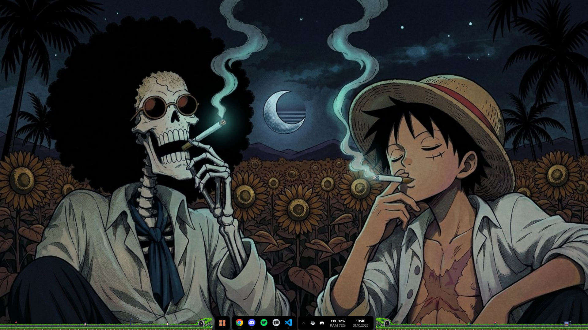
</p>

---

## Neden Taskbaroque?

- **Hafif.** Rust ile, doğrudan Win32 ve Direct2D kullanılarak yazıldı. Tarayıcı motoru veya arka planda çalışan ağır bir çatı yok. Her şey tek bir `.exe` içinde.
- **Masaüstün bozulmaz.** Windows görev çubuğu yalnızca gizlenir, "otomatik gizle" ayarına dokunulmaz. Simgeler ve pencereler yerinden kaymaz.
- **Çoklu ekran.** Her ekranda ayrı bir çubuk olur. İstersen her çubuk sadece kendi ekranındaki pencereleri gösterir.
- **Güvenli çıkış.** Uygulamadan çıktığında Windows görev çubuğu hemen geri gelir.

## Kurulum

1. [Releases](https://github.com/ahmetcdincer/taskbaroque/releases/latest) sayfasından `Taskbaroque-Setup-x.y.z.exe` dosyasını indir.
2. Çalıştır. Yönetici izni gerekmez.
3. Kurulumda masaüstü kısayolu ve "Windows ile başlat" seçeneklerini işaretleyebilirsin.

Kaldırmak için **Ayarlar → Uygulamalar** bölümünden Taskbaroque'u seç. Ayarların silinmez; yeniden kurduğunda kaldığın yerden devam edersin.

> **Gereksinimler:** Windows 11, 64 bit.

---

## Özellikler

### Görev çubuğu

- **Dört görünüm:** Yuvarlak, Modüler, Dock ve Tam genişlik. Tam genişlikte Başlat düğmesi ortada kalır.
- **Gruplanan pencereler.** Aynı uygulamanın pencereleri tek simgede toplanır. Üzerine gelince canlı önizlemeler açılır; buradan istediğin pencereye geçebilir ya da pencereyi kapatabilirsin.
- **Sürükle ve bırak.** Bir dosyayı simgenin üzerinde tuttuğunda uygulama öne gelir. Birden fazla penceresi varsa önizlemeler açılır.
- **Sabitleme.** Uygulamaları çubuğa sabitleyebilirsin. Windows görev çubuğundaki sabitlemelerin ilk açılışta otomatik olarak alınır.
- **Sıralama.** Simgeleri sürükleyerek yerlerini değiştirebilirsin. Yeni açılan uygulamalar sağa eklenir, senin sıran korunur.
- **Sağ tık menüsü.** Uygulamanın kendi seçenekleri, son kullanılan dosyalar, Görev Yöneticisi, sabitleme ve gizleme bir arada.
- **Dikkat isteyen uygulamalar.** Bildirim gönderen bir uygulamanın simgesi turuncu yanar.
- **Bildirim alanı.** Tepsi simgeleri ve gizli simgeler paneli. Tek ve çift tıklama Windows'taki gibi çalışır.
- **Sağ blok.** Hava durumu, CPU ve RAM, pil, saat ve sanal masaüstü noktaları.
- **Kendi başlatıcın.** Başlat düğmesi, Windows menüsü yerine hızlı bir uygulama arayıcısı açabilir. Başlat simgesini kendi görselinle değiştirebilirsin.
- **Klavye kısayolları.** `Win + 1…9` çubuktaki uygulamaları açar, `Alt + Boşluk` başlatıcıyı açar.
- **Tam ekran algılama.** Oyun veya video tam ekrandayken çubuk o ekranda kendini gizler.

### Çentik

Ekranın üstünde duran, üzerine gelince açılan bir panel. Müzik çalarken küçük ses çubukları hareket eder. Sesi değiştirdiğinde bir ses göstergesi, mikrofon veya kamera kullanıldığında bir uyarı belirir. Görünürlük seçenekleri: her zaman, medya çalarken, üzerine gelince ya da kapalı.

| | |
|---|---|
| 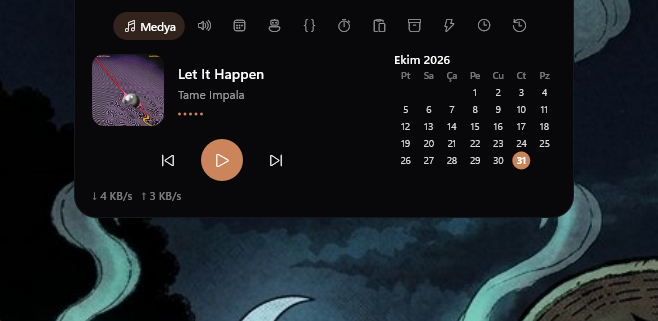 | 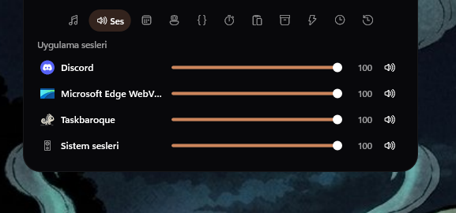 |
| **Medya:** Çalan şarkı, kapak, kontroller, takvim ve ağ hızı. | **Ses:** Her uygulamanın ses seviyesi ayrı ayrı. |
| 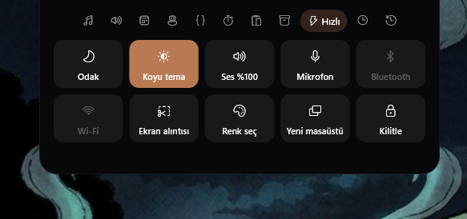 | 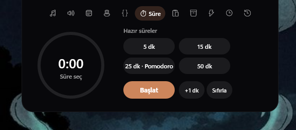 |
| **Hızlı:** Odak modu, koyu tema, ses, mikrofon, Bluetooth, Wi-Fi, ekran alıntısı, renk seçici, yeni masaüstü ve kilitleme. | **Süre:** Hazır süreler ve Pomodoro zamanlayıcısı. |
| 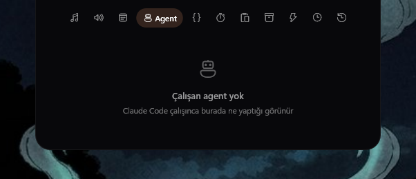 | 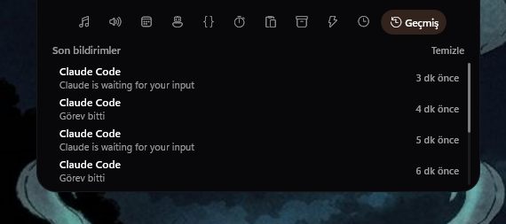 |
| **Agent:** Claude Code'un o an ne yaptığı, canlı olarak. | **Geçmiş:** Son bildirimler. Tıklayınca ilgili uygulamaya gider. |

Diğer sekmeler:

- **Ajanda:** Google veya Outlook takvimindeki etkinlikler (ICS bağlantısıyla).
- **GitHub:** Açık PR'lar ve CI durumu (`gh` CLI ile).
- **Pano:** Son kopyaladıkların.
- **Raf:** Dosyaları geçici olarak bırakabileceğin bir alan.
- **Ekran süresi:** Bugün hangi uygulamada ne kadar zaman geçirdiğin. Akşam kısa bir günlük özet gelir.

Bluetooth kulaklık ve fare gibi cihazların pil seviyesi de Hızlı sekmesinde görünür. Pil azaldığında uyarı gelir.

### Widget'lar

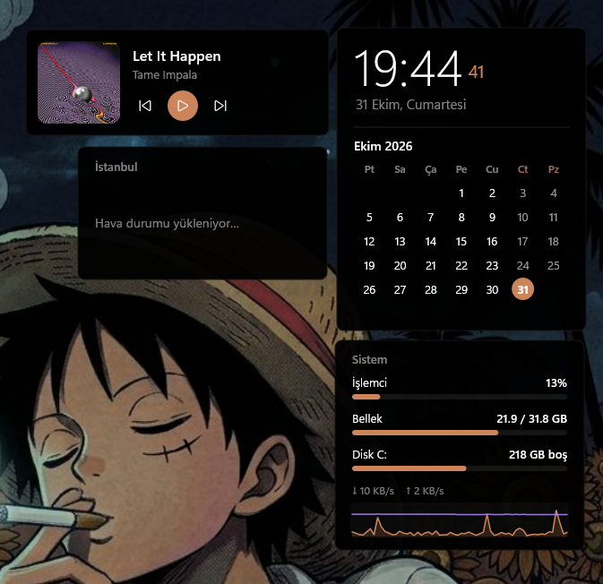

- **Saat ve takvim**
- **Hava durumu** (Open-Meteo, API anahtarı gerekmez)
- **Medya:** Kapak resmi ve kontroller.
- **Sistem monitörü:** CPU, RAM, disk, ağ ve 60 saniyelik grafik.
- **Yapışkan not:** İçine tıklayıp yaz, otomatik kaydedilir. Sarı, pembe, yeşil, mavi, mor ya da tema rengi.
- **Yapılacaklar:** Görev ekle, işaretle, düzenle, sil. Tamamlananları tek tıkla temizle.
- **Döviz, altın ve kripto:** Dolar, Euro, gram altın, Bitcoin, Ethereum ve daha fazlası; günlük değişimle. API anahtarı gerekmez.
- **Fotoğraf çerçevesi:** Seçtiğin klasördeki fotoğrafları sırayla gösterir.
- **GitHub:** Açık pull request'lerin ve CI durumları (gh CLI ile).

Widget'ları sürükleyerek taşıyabilir, başka bir ekrana götürebilir ve yerlerine kilitleyebilirsin. Konumları otomatik kaydedilir.

### Evcil hayvan

Çubuğun yanında dolaşan pixel art bir karakter. Yürür, koşar, zıplar, uyur; fareyle tutup taşıyabilir, üzerine gelip sevebilirsin. Ayarlar → Evcil hayvan → **Karakter**'den seç.

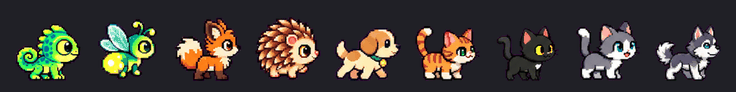

**Bukalemun, Ateş böceği, Tilki, Kirpi, Köpek, Turuncu kedi, Siyah kedi, Gri kedi** ve **Kurt köpeği**. Her birinin kendine özgü bir hareketi var: tilki atılır, kirpi top olup yuvarlanır, kedi gerinir, kurt köpeği uluyor…

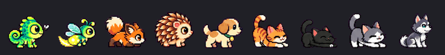

İlk beş pet için klasik çizimler de duruyor: Ayarlar → Evcil hayvan → **Pixel art** kapalı.

### Manzaralar

Çubuğun iki yanı pixel art bir manzara olabilir; pet onun zemininde yürür. Ayarlar → Evcil hayvan → **Arazi türü**'nden seç. Her manzarada önemli yerler (camiler, Dünya, kulübe…) yalnızca **bir kez** görünür ve çubuğun iki yanına paylaştırılır; hiçbir şey tekrar etmez. Gece 20:00–06:00 arası, gece hâli olan manzaralar kendiliğinden değişir.

Aşağıdaki görsellerde üst satır çubuğun **solu**, alt satır **sağıdır**.

**İstanbul** — vapur, Ayasofya, Sultanahmet, Galata Kulesi, Boğaz Köprüsü

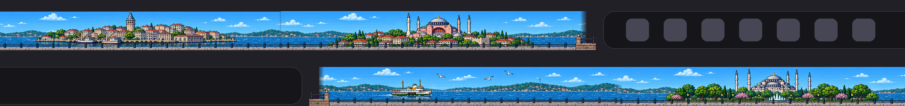

<details><summary>Gece</summary>

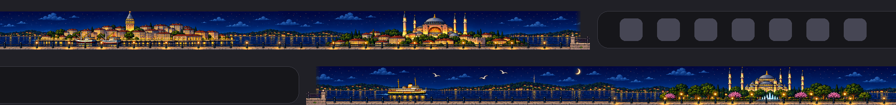
</details>

**Antalya** — gulet, Düden Şelalesi, Kaleiçi ve Yivli Minare, Hadrian Kapısı, Konyaaltı

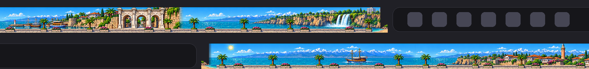

<details><summary>Gece</summary>

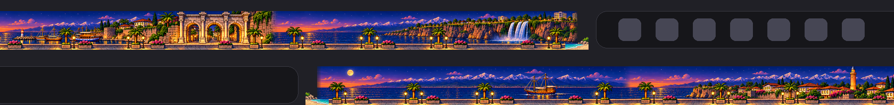
</details>

**Dağlar** — çam ormanı ve geyikler, karlı zirve ve göl, şelale, kütük kulübe, çayırlar

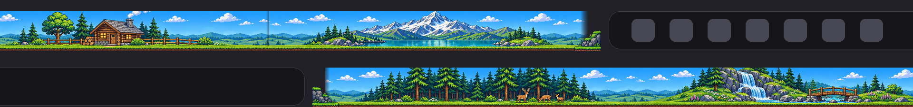

<details><summary>Gece</summary>

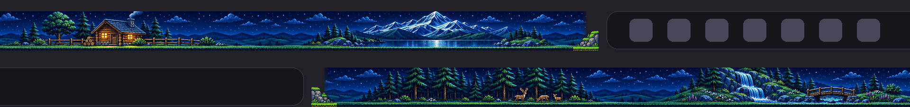
</details>

**Karlı köy** — fenerli orman, ışıklı kulübe, donmuş gölet, köy meydanı, şapel

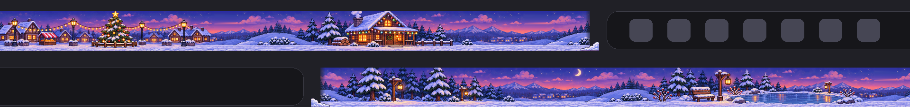

**Ay** — kraterler, doğan Dünya, ay üssü, iniş aracı ve gezici

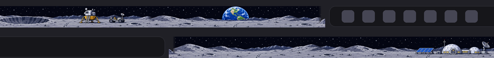

**Uzay** — bulutsu, halkalı gezegen, uzay istasyonu, asteroit kuşağı, galaksi

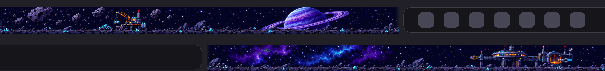

**Stadyum** — dolu tribünler, iki kale, gece maçında projektörler

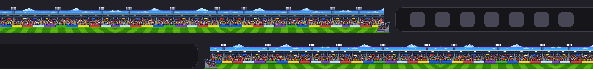

<details><summary>Gece</summary>

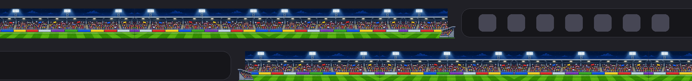
</details>

**Yol** — tünelli yol; zaman zaman bir araba geçer, bir tünele girip diğerinden çıkar.

#### Sahneler

Bazı manzaralarda arada bir kısa bir sahne oynar (işlemciyi yormamak için 25–70 saniyede bir):

- **Ay ve Uzay — uzay savaşı:** Bir savaşçı gelir, karşıdan uzaylılar yaklaşır, savaşçı lazerle ateş eder, vurulanlar patlar.

  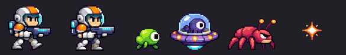

- **Stadyum — gol atağı:** Bir oyuncu topu sürer, rakip peşine düşer, kaleci atlar ama yetişemez; gol olunca konfeti patlar.

  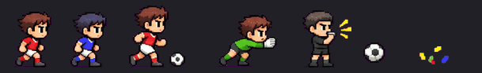

Sahneleri manzaranın altındaki **Uzay savaşı / Futbol maçı** seçeneğinden kapatabilirsin.

### Temalar

12 hazır tema: Gece mavisi, Aydınlık, Aurora, Buzlu cam, Neon, Orman, Fırçalı metal, Retro piksel, Pastel, Minimal, Gün batımı ve Siyah (AMOLED). İstersen vurgu rengi duvar kağıdından alınır.

### Bildirimler

Taskbaroque, terminalde ve kod editöründe çalışan araçlardan bildirim alıp çentikte gösterebilir. Bildirime tıkladığında ilgili pencere öne gelir.

**Claude Code:** Taskbaroque açılırken Claude Code hook'larını `%USERPROFILE%\.claude\settings.json` dosyasına kendisi ekler. Önce dosyanın yedeğini alır, başka araçların hook'larına dokunmaz. Çentik çalışan, onay bekleyen ve biten oturumları gösterir; terminali (Warp dahil) öne getirmek için oturuma tıkla. Claude Code ayarları oturum açılırken okuduğundan, açık oturumları bir kez yeniden başlat.

**Sesler:** Ayarlar → **Bildirimler**'den ses türünü seç: Melodi, Yumuşak, Zil, Retro (8-bit), Windows sesleri ya da kendi `.wav` dosyan. Ses seviyesini ayarla; görev bitince, onay beklerken ve hata olunca çalıp çalmayacağını ayrı ayrı seç.

Elle eklemek istersen hook'lar şöyle görünür (`<kullanıcı>` yerine kendi kullanıcı adını yaz):

```json
{
  "hooks": {
    "UserPromptSubmit":   [{ "hooks": [{ "type": "command", "command": "\"C:/Users/<kullanıcı>/AppData/Local/Programs/Taskbaroque/taskbaroque.exe\" --hook", "timeout": 10 }] }],
    "PreToolUse":         [{ "hooks": [{ "type": "command", "command": "\"C:/Users/<kullanıcı>/AppData/Local/Programs/Taskbaroque/taskbaroque.exe\" --hook", "timeout": 10 }] }],
    "PostToolUse":        [{ "hooks": [{ "type": "command", "command": "\"C:/Users/<kullanıcı>/AppData/Local/Programs/Taskbaroque/taskbaroque.exe\" --hook", "timeout": 10 }] }],
    "PostToolUseFailure": [{ "hooks": [{ "type": "command", "command": "\"C:/Users/<kullanıcı>/AppData/Local/Programs/Taskbaroque/taskbaroque.exe\" --hook", "timeout": 10 }] }],
    "PermissionRequest":  [{ "hooks": [{ "type": "command", "command": "\"C:/Users/<kullanıcı>/AppData/Local/Programs/Taskbaroque/taskbaroque.exe\" --hook", "timeout": 10 }] }],
    "Notification":       [{ "hooks": [{ "type": "command", "command": "\"C:/Users/<kullanıcı>/AppData/Local/Programs/Taskbaroque/taskbaroque.exe\" --hook", "timeout": 10 }] }],
    "Stop":               [{ "hooks": [{ "type": "command", "command": "\"C:/Users/<kullanıcı>/AppData/Local/Programs/Taskbaroque/taskbaroque.exe\" --hook", "timeout": 10 }] }],
    "StopFailure":        [{ "hooks": [{ "type": "command", "command": "\"C:/Users/<kullanıcı>/AppData/Local/Programs/Taskbaroque/taskbaroque.exe\" --hook", "timeout": 10 }] }],
    "SessionEnd":         [{ "hooks": [{ "type": "command", "command": "\"C:/Users/<kullanıcı>/AppData/Local/Programs/Taskbaroque/taskbaroque.exe\" --hook", "timeout": 10 }] }]
  }
}
```

Uygulamayı güncellediğinde veya başka bir klasöre kurduğunda bu yollar otomatik olarak düzeltilir. Kaldırdığında hook'lar da temizlenir.

**Kendi komutların:** Herhangi bir betikten bildirim gönderebilirsin:

```powershell
taskbaroque.exe --notify "Derleme bitti" --title "Warp" --sound
```

---

## Ayarlar

Ayarlar penceresini açmak için çubuğa sağ tıklayıp **Ayarlar**'ı seç. Her şey buradan değiştirilebilir ve değişiklikler anında uygulanır.

| | |
|---|---|
| 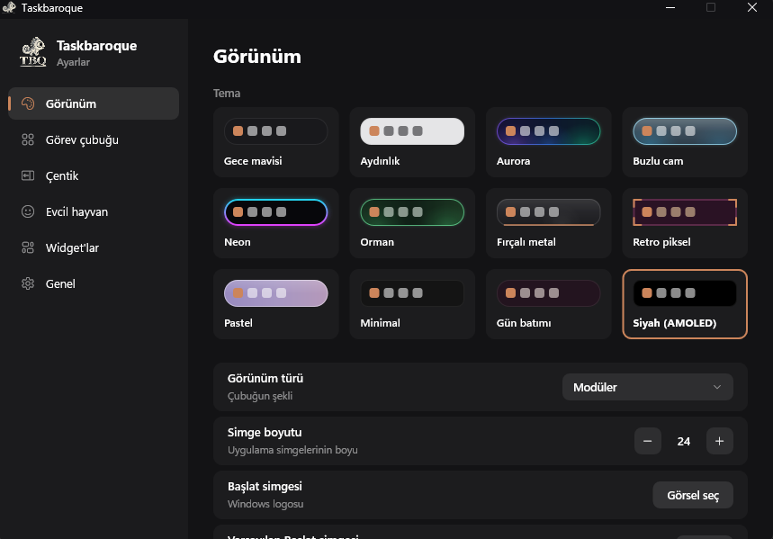 | 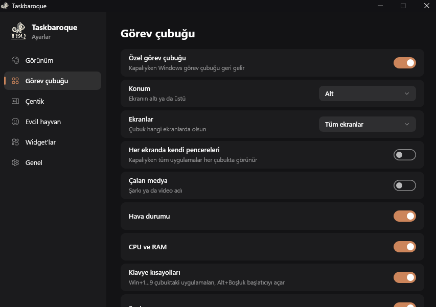 |
| 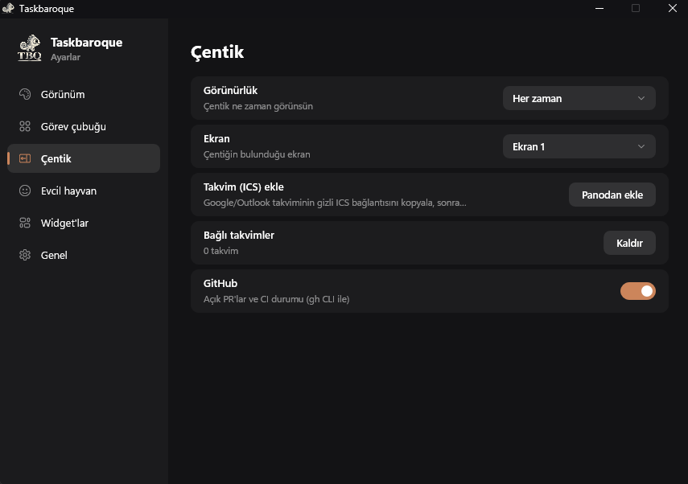 | 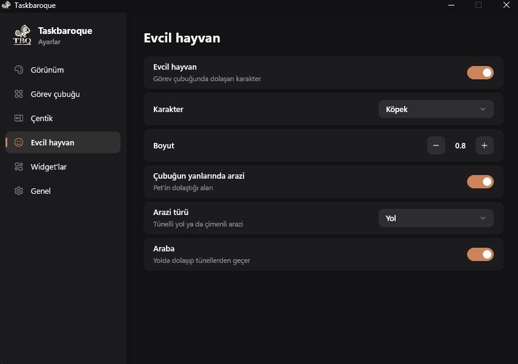 |
| 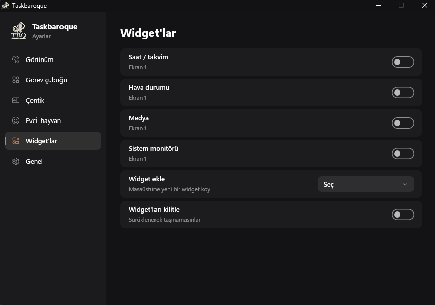 | 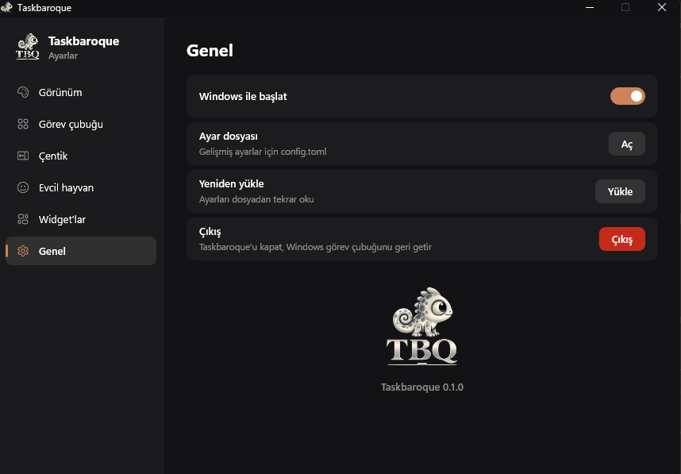 |

Gelişmiş ayarlar `%APPDATA%\Taskbaroque\config.toml` dosyasında durur. Dosyayı kaydettiğin anda değişiklikler uygulanır. `[themes.isim]` bölümüyle kendi temanı da tanımlayabilirsin.

Arayüz Türkçe ve İngilizce dillerini destekler.

---

## Sorun giderme

- **Windows görev çubuğu geri gelmedi:** Uygulama zorla kapatıldıysa `taskbaroque.exe --restore` komutunu çalıştır.
- **Bir tepsi simgesi açılmıyor:** Bazı uygulamalar yalnızca çift tıklamayla açılır; simgeye çift tıkla.

## Kaynaktan derleme

```powershell
cargo build --release
target\release\taskbaroque.exe
```

Simgenin exe'ye gömülmesi için `windres` (MinGW) gerekir. Kurulum dosyası [Inno Setup 6](https://jrsoftware.org/isinfo.php) ile oluşturulur:

```powershell
ISCC.exe installer\taskbaroque.iss
```

`main` dalına yapılan her push, GitHub Actions üzerinden otomatik olarak yeni bir sürüm yayınlar.

## Lisans

[LICENSE](LICENSE) dosyasına bak.
